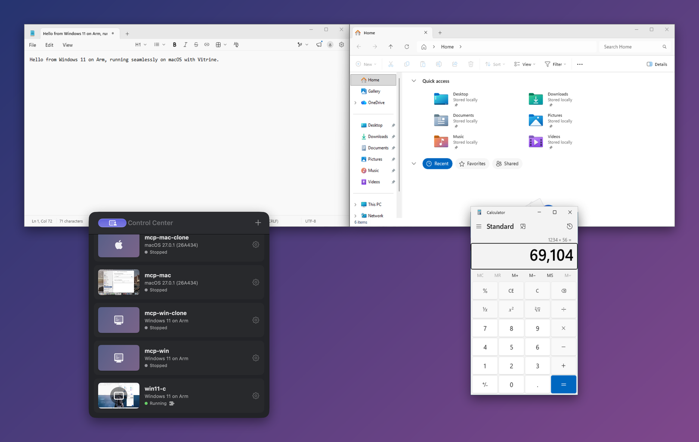

# Vitrine

[English](README.md) · [繁體中文](README.zh-Hant.md) · **简体中文** · [日本語](README.ja.md)
> 本文译自[英文版](README.md)，内容如有出入以英文版为准。

[](https://github.com/cioufong/vitrine/actions/workflows/ci.yml)

**免费、开源的 Apple Silicon 虚拟机，你和你的 AI 智能体都能操控——支持 macOS、Linux 和 Windows。**

Vitrine 通过 Apple 的 Virtualization.framework 以原生速度运行虚拟机（macOS 和 Linux 客户机）；在 Apple 的框架无法胜任时（Windows 11、x86_64 模拟）则改用 QEMU。采用 Apache-2.0 许可证。

- **面向 AI 智能体**：`vitrinectl mcp` 是一个 [Model Context Protocol](docs/mcp.md) 服务器。智能体可以通过无人值守安装创建 Windows 11 或 Debian 虚拟机（在 macOS 27 主机上也可以创建 macOS），然后查看它的屏幕、点按、以任意语言输入文字、通过 SSH 运行命令和复制文件，并为它拍摄快照或克隆：一台干净的机器，可用来测试应用、复现 bug，或让智能体在里面工作，而不是直接在你的 Mac 上操作。一切都在本地运行，不会发送到任何云服务。
- **面向你**：那些人们愿意付费购买的集成功能：客户机应用作为普通窗口出现在你的桌面上（无缝模式）、共享剪贴板、共享文件夹、即时快照、挂起／恢复以及一键安装。



> 状态：v0.1，正在积极开发中。请参阅[目前可用的功能](#what-works-today)（附带日期的测试结果见 [docs/verification.md](docs/verification.md)）以及[路线图](#roadmap)。

### 下载

从[最新发布版本](https://github.com/cioufong/vitrine/releases/latest)下载 `Vitrine-<version>.zip`，解压后将 `Vitrine.app` 移到“应用程序”文件夹。该应用采用 ad-hoc 签名，尚未经过公证，因此 macOS 会阻止它首次启动；而在 macOS 15 及更高版本上，右键点按 ▸「打开」已无法绕过这一限制：请先打开 Vitrine 一次，然后前往 **系统设置 ▸ 隐私与安全性**，向下滚动并点按 **「仍要打开」**（或运行 `xattr -dr com.apple.quarantine /Applications/Vitrine.app`）。应用自带的命令行工具和 MCP 服务器为 `/Applications/Vitrine.app/Contents/MacOS/vitrinectl`。

### 让智能体来操控

```bash
./scripts/build-cli.sh                                        # → .build/release/vitrinectl
claude mcp add vitrine -- "$PWD/.build/release/vitrinectl" mcp  # 或任意 MCP 客户端，参见 docs/mcp.md
```

然后可以这样提问，例如：*“创建一台名为 win-test 的 Windows 11 虚拟机，等它设置完成后在里面安装 7-Zip，并截取 7-Zip 打开时的屏幕截图。”* 智能体会使用 `create_vm`，轮询 `create_status`，并通过 `exec`、`screenshot`、`click` 和 `type_text` 操作客户机；客户机账户的密码保存在虚拟机包内，永远不会向智能体显示。

## 亮点

| 功能 | Vitrine 支持情况与要求 |
|---|---|
| 价格／许可证 | 免费，Apache-2.0 |
| AI 智能体（MCP） | 创建（无人值守安装 Debian 13、Windows 11、macOS）、克隆、启动／停止、屏幕截图、点按、输入（美式键盘，或通过客户机代理输入任意字符）、SSH 执行与文件复制、快照——[docs/mcp.md](docs/mcp.md) |
| 无缝客户机窗口 | macOS、Linux/X11 和 Windows 客户机代理 |
| 一键安装 macOS | macOS 27 自动配置＋自动安装代理 |
| 一键安装 Linux 桌面 | 基于云镜像＋cloud-init 的 Debian 13 Xfce |
| Windows 11 on Arm／x64 | QEMU＋HVF／实验性 TCG 模拟 |
| 快照 | 对虚拟机包内磁盘进行 APFS 克隆，可选保存内存状态；参见下文“快照安全” |
| 挂起／恢复 | VZ 和 QEMU，包括 Windows on Arm |
| 退出行为 | 默认挂起正在运行的虚拟机；失败时会报告，而不是悄悄丢弃状态 |
| 剪贴板 | macOS：文本、RTF、HTML、图像；Linux/Windows：文本和 PNG |
| 将文件拖入虚拟机 | macOS 和 Windows 客户机；Linux 客户机接收文件仍在路线图中 |
| 共享文件夹 | VZ 客户机使用 virtiofs；Windows 客户机使用 Samba |
| GPU | macOS 客户机使用 Metal；Linux 和 Windows 使用 2D 显示，3D 仍在路线图中 |
| USB 直通 | QEMU 支持主机 USB；VZ 主机 USB 需要 macOS 27 和 Apple 的受限权限（entitlement） |
| 客户机应用出现在 Mac 程序坞中 | 代理提供的应用目录和程序坞代理启动器 |
| 虚拟机窗口状态栏 | 来自代理的客户机 CPU、内存、磁盘、运行时间和 IP；网线、剪贴板、显示分辨率自动调整、摄像头、蓝牙和 USB 的开关（显示 ▸ 显示状态栏，⌘/） |
| 在客户机中使用 Mac 摄像头 | Linux 客户机：状态栏开关打开时，代理会把 Mac 的摄像头变成一个 v4l2loopback 网络摄像头；macOS 客户机：代理的 *Vitrine Camera* 扩展，需要团队签名的代理；Windows 11 客户机：Media Foundation 虚拟摄像头（[docs/camera.md](docs/camera.md)） |
| 在客户机中使用 Mac 蓝牙（实验性） | Linux 客户机会获得一个模拟的低功耗蓝牙（Bluetooth LE）控制器（`hci0`），其扫描、连接和 GATT 通信都经由 Mac 的蓝牙进行（[docs/bluetooth.md](docs/bluetooth.md)） |
| 网络 | NAT、仅主机、命名的虚拟机间网络、桥接（root 辅助程序）、TCP/UDP 端口转发——[docs/networking.md](docs/networking.md) |
| 磁盘格式 | ASIF（macOS 26+）或稀疏 raw |
| CLI | `vitrinectl` |

<a id="what-works-today"></a>
## 目前可用的功能

已在运行 macOS 27 的 M1 Max 上完成端到端验证：

- **macOS 客户机**：下载 IPSW → 安装 → 首次启动时创建你的账户（不经过设置助理），启用 SSH，Vitrine 自动安装其代理；无缝模式下窗口以 1:1 Retina 清晰显示，支持鼠标、键盘（包括快捷键和合成文本输入）、双向剪贴板；可从访达把文件拖到虚拟机上（文件会出现在客户机桌面）；挂起／恢复；APFS 快照。
- **Linux 客户机（VZ）**：UEFI＋ISO 安装、直接内核启动（gzip 和 EFI-zboot 内核会自动解包）、通过 cloud-init 一键安装 **Debian 13 Xfce**（用户、SSH、桌面、自动登录、virtiofs 挂载）、通过 Rosetta 运行 x86_64 二进制文件、串口控制台日志。
- **QEMU 后端**：基于 HVF 的 aarch64 和 x86_64 模拟（TCG）、UEFI、NVMe、USB 安装介质、为 Windows 11 提供的 TPM 2.0（swtpm）、应用内置的 VNC 显示（使用原始扫描码）、QMP 控制、通过迁移实现挂起／恢复（期间会热拔出 USB 音频，因此连 Windows on Arm 也能挂起）。
- **Windows 11 on Arm（QEMU＋HVF）**：已用官方 26H2 ISO（版本 26300.9457）验证——完全无人值守安装（账户、自动登录、virtio 驱动程序、OpenSSH、Vitrine 代理），代理在首次登录时即连接；键盘（包括 Unicode 文本）、焦点、窗口列表、画面捕获和双向剪贴板均通过 `vitrinectl agent probe`；挂起／恢复（6 GB 内存映像，约 50 秒）以及从已安装磁盘冷启动。安装阶段运行在 ramfb 上；之后 Windows 以 1920×1080 使用 virtio-gpu（viogpudo），Vitrine 会自行完成收尾工作（弹出安装介质、删除含密码的种子文件、再次启动）。
- **Windows 11 x64（TCG 模拟）**——实验性。2026-10-18 记录的验收运行中，在 M1 Max 上用 1 小时 53 分钟完成了无人值守安装，包括 SSH 和代理。离线安装和预置的 OpenSSH 避免了早先在 OOBE／Windows 更新阶段卡住的问题。完整的 x64 模拟仍比 Windows on Arm 慢得多；参见[实测结果](docs/benchmarks.md)。这些是该配置下记录的结果，并非针对所有 Windows ISO 或主机的验收测试。
- **验证**：哪些功能在全新安装的 Debian、Windows 11 Arm 和 macOS 上测试过、在哪一天和哪个提交上测试，以及显示延迟和已知问题——[docs/verification.md](docs/verification.md)。
- **日常虚拟机功能**：一次性模式（每次运行都从同一个磁盘开始）、拥有独立 MAC 地址和 DHCP 主机名的 APFS 克隆、NAT／仅主机／带固定地址的命名虚拟机间网络／桥接（通过一个只需安装一次的小型 root 辅助程序）／无网络，两种后端均支持 TCP 和 UDP 端口转发（[docs/networking.md](docs/networking.md)）、共享文件夹（VZ 上为 virtiofs，QEMU Linux 上为 9p）、串口控制台（`vitrinectl console`，可脚本化）、QEMU GDB stub、通过 SSH 推送／拉取文件、导入 qcow2/VMDK/VHDX/VDI 磁盘和 UTM 虚拟机、用于自动化的 `vitrine://start|show|suspend|stop?vm=NAME` URL、虚拟机运行期间保持 Mac 不休眠，以及为 x86_64 QEMU 客户机提供使用 Microsoft 密钥的安全启动（已验证 Debian 的签名 shim → GRUB；开启安全启动的 Windows 尚未验证）。
- **语言**：应用提供英语、繁体中文、简体中文和日语界面，并跟随“系统设置”中设定的语言；如何添加新语言见 [CONTRIBUTING.md](CONTRIBUTING.md#translations)。CLI 为英文。
- **AI 智能体（MCP）**：`vitrinectl mcp` 让 MCP 客户端可以创建无人值守安装 Debian、Windows 11 或 macOS 的虚拟机，克隆它们，启动和停止它们，查看它们的屏幕，进行输入和点按（作为虚拟机自己的键盘和指针，因此在登录界面和安装程序中也可以使用），通过 SSH 运行命令和复制文件，以及拍摄快照——参见 [docs/mcp.md](docs/mcp.md)。美式键盘无法输入的文本（重音字符、中日韩文字、emoji）会通过客户机代理输入。迄今已完全通过 MCP 端到端创建的有：无头 Debian 13、Windows 11 Arm 和 macOS 27；Unicode 输入已在 Debian Xfce 终端、Windows PowerShell 和 macOS 终端中逐字节核对（在代理不能输入时通过客户机剪贴板粘贴）（[验证](docs/verification.md)）。
- **客户机代理**：macOS（Swift）、Linux/X11 和 Windows（同一套 Go 代码）。Windows 使用 GDI 捕获和 `SendInput`；其代理默认等待 virtio-serial。TCP 是一种需要显式启用、安全性较弱的兼容性传输方式，不会作为客户机代理的自动回退方案。

> **恢复需要 Mac 处于解锁状态。** Virtualization.framework 使用一个安全隔区（Secure Enclave）密钥加密已保存的虚拟机内存，而 macOS 只有在你已登录且已解锁时才会释放该密钥。在屏幕锁定时尝试恢复会失败；Vitrine 会保留已保存的状态，并提示你解锁后重试（或者通过 **丢弃挂起状态（Discard Suspended State）**／`vitrinectl discard-state` 丢弃它）。

## 无缝模式的工作原理

```
 guest (VM)                                           host (your Mac)
┌───────────────────────────┐  vsock (VZ) or     ┌──────────────────────────────────┐
│ Vitrine Agent              │  virtio-serial     │ AgentSession                     │
│  • one display stream     │ ─────────────────► │  • IOSurface framebuffer         │
│    (ScreenCaptureKit /    │  dirty rects       │ CoherenceController              │
│    X11 damage), no        │  window list       │  • one borderless NSWindow per   │
│    wallpaper/Dock/shadows │                    │    guest window, cropping the    │
│  • window geometry        │ ◄───────────────── │    shared surface (contentsRect) │
│  • input injection        │  pointer, keys,    │  • native host shadows & z-order │
│  • clipboard sync         │  focus, clipboard  │ DisplaySink keeps the guest at   │
└───────────────────────────┘                    │  host-screen resolution          │
                                                 └──────────────────────────────────┘
```

一个捕获流供给所有窗口，因此无论打开了多少个客户机窗口，一次帧更新都只是向共享 IOSurface 执行一次 `memcpy`。（代码中把这项功能称为 *Coherence*：`CoherenceController`、`--coherence`。）设计和代码均为净室实现——没有查看或使用任何专有代码。

## 系统要求

- 搭载 Apple Silicon 的 Mac，macOS 14+（推荐 macOS 27：可自动设置 macOS 账户、支持 ASIF 磁盘）
- 构建需要 Xcode 16+／Swift 6
- Windows／x86_64 客户机需要：`brew install qemu swtpm`
- Windows 共享文件夹以及从主机向客户机投放文件需要：`brew install samba`
- Linux 无缝集成需要 X11 会话；不支持 Wayland。

## 构建与运行

```bash
git clone https://github.com/cioufong/vitrine && cd vitrine
./scripts/build-app.sh          # → dist/Vitrine.app（带虚拟化权限的 ad-hoc 签名）
open dist/Vitrine.app
```

ad-hoc 构建不需要 Apple 账户。VZ 自带的桥接网络、VZ USB 直通以及 macOS 客户机摄像头需要 Apple 授予开发者团队的权限（entitlement）。要启用这些功能，请用你自己的团队为构建签名：参见 [docs/signing.md](docs/signing.md)。

使用 **文件 → 新建…**（File → New…，即安装助理）：

- **下载 macOS**——你的 Mac 支持的最新版本。
- **Debian 13 (Xfce)**——现成的桌面，自动完成配置。
- **Linux**——任意 arm64 安装 ISO（Ubuntu、Fedora、Debian……）。
- **Windows 11**——选择一个 Microsoft ISO；可选 Arm64（推荐——x64 应用通过 Prism 运行）或 x64（完全模拟，实验性）。

要在 macOS 虚拟机中使用无缝模式，请在虚拟机窗口顶部的横栏中点按一次 **允许…**（或选择 *操作 ▸ 允许 Vitrine Agent 控制…*），并在虚拟机内允许两个提示（录屏和辅助功能），然后按 **⌃⌘C**（或点按工具栏按钮）。由 `vitrinectl run` 运行的虚拟机则通过 `vitrinectl agent permissions <vm>` 发起请求。在你这样做之前，代理不会请求任何权限，因此只从主机端操控的虚拟机永远不会显示这些提示。Linux 和 Windows 代理不需要任何权限：按 **⌃⌘C** 即可；选择 *操作 ▸ 退出无缝模式*（或再按一次 ⌃⌘C）可以恢复虚拟机窗口。

### 命令行

```bash
./scripts/build-cli.sh                                   # .build/release/vitrinectl
vitrinectl create dev --user me --password '…'            # macOS 虚拟机
vitrinectl create-linux deb --distro debian-13 --user me --password '…'
vitrinectl create-linux alpine --iso alpine.iso           # 任意 Linux ISO（VZ）
vitrinectl create-windows win --iso Win11_Arm64.iso --user me --password '…'   # 无人值守安装 Windows 11
vitrinectl set win --eject                                # 安装完成后：卸下安装介质和种子介质
vitrinectl agent probe win --editor Notepad               # 端到端代理检查（QEMU 客户机）
vitrinectl run dev [--gui] [--console]                    # Ctrl-C 关机
vitrinectl suspend dev                                    # 用 `run` 恢复（对应用中运行的虚拟机同样有效）
vitrinectl discard-state dev                              # 丢弃已保存的内存，下次从磁盘启动
vitrinectl snapshot create dev clean-install
vitrinectl share add dev ~/Projects
vitrinectl exec dev 'uname -a'                            # 通过 SSH 在客户机中运行命令
vitrinectl agent install dev
vitrinectl agent camera dev                               # 安装客户机的虚拟摄像头（Linux、Windows 11）
vitrinectl agent bluetooth dev                            # Linux 客户机：安装蓝牙桥接（BlueZ、hci_uart）
vitrinectl agent permissions mac                          # macOS 客户机：在客户机中请求代理的无缝模式权限
vitrinectl screenshot win shot.png                        # 任意正在运行的虚拟机
vitrinectl keys deb --combo ctrl+alt+t; vitrinectl click deb 640 400
vitrinectl mcp                                            # 供 AI 智能体使用的 MCP 服务器（docs/mcp.md）
vitrinectl set deb --disposable on                        # 每次运行后丢弃所做的更改
vitrinectl port add deb 2222:22                           # 将主机 127.0.0.1:2222 转发到客户机 SSH
vitrinectl network create lab; vitrinectl set deb --network network:lab   # 虚拟机间网络
vitrinectl set deb --network bridged:en0                  # 在局域网上拥有自己的地址（docs/networking.md）
vitrinectl push deb ./notes /home/me/notes                # 复制进去（pull 为复制出来）
vitrinectl console deb                                    # 串口控制台；Ctrl-] 断开
vitrinectl import old.utm                                 # 或 .qcow2/.vmdk/.vhdx/.vdi 磁盘
open 'vitrine://start?vm=deb'                             # 从脚本启动／显示／挂起／停止
vitrinectl list
```

### 快照安全

可写磁盘必须是普通文件，并通过虚拟机包内的安全路径引用。快照和克隆在做出任何更改之前，会拒绝外部可写磁盘、父目录遍历和符号链接别名。请先把这些磁盘移入虚拟机包，或以只读方式挂接。外部只读介质只会被引用而不会被纳入快照；请让它们保留在原来的位置。

恢复快照时，会先检查其清单、所需磁盘和已保存内存的元数据，然后才替换虚拟机状态。不完整的旧版快照会被拒绝。带有可写热插拔 USB 介质或主机 USB 设备的已保存状态无法安全地拍摄快照；保存前请先关机或断开这些设备。共享的主机文件夹不在快照范围内，永远不会被回滚。

如果恢复及其回滚都失败，Vitrine 会保留原始备份，报告其恢复目录，并在该工作区恢复完成之前阻止虚拟机启动和再次恢复。在恢复其中的文件之前，切勿删除保留下来的 `.restore-*` 目录。

### 测试

```bash
swift test                     # 单元测试（协议、帧缓冲、无缝窗口管线、QEMU 参数……），
                               # 针对脚本化客户机的代理探测，macOS 输入注入只记录、不实际发送
python3 scripts/tests/lifecycle-integrity.py "$(swift build -c release --show-bin-path)/vitrinectl"
                               # 一次性 CLI 虚拟机包＋合成 QMP 故障恢复；需先构建 release
./scripts/smoke-linux.sh       # 在 Virtualization.framework 上启动 Alpine
./scripts/smoke-qemu.sh        # 在 QEMU/HVF 上启动 Alpine，挂起并恢复
ARCH=x86_64 ./scripts/smoke-qemu.sh   # 同上，使用 x86_64 模拟
./scripts/tests/ninep-share-e2e.sh     # QEMU Linux：串口控制台登录、9p 共享文件夹、GDB stub
./scripts/tests/network-qemu-e2e.sh    # QEMU Linux：端口转发、NAT 下可上网、仅主机下不能上网
./scripts/tests/secureboot-e2e.sh      # x86_64 QEMU：拒绝未签名的加载程序，Debian 的签名 shim 可启动
./scripts/tests/automation-qemu-e2e.sh # QEMU：通过 QMP 截屏、输入和点按
python3 scripts/tests/mcp-e2e.py "$(swift build --show-bin-path)/vitrinectl" <vm>  # 针对正在运行的桌面虚拟机测试 MCP
python3 scripts/tests/mcp-create-e2e.py "$(swift build --show-bin-path)/vitrinectl" <new-vm>  # MCP 创建、克隆、快照
python3 scripts/tests/mcp-unicode-e2e.py "$(swift build --show-bin-path)/vitrinectl" <vm> [linux|windows|macos]  # 非美式键盘输入
open dist/Vitrine.app --args --coherence-demo   # 针对合成客户机测试无缝模式
```

cloud-init YAML 测试需要 Python 3 和 PyYAML（CI 固定为 6.0.3）。GUI 集成测试需要可用的显示器，没有显示器时会显式跳过。套接字、Samba 和 ISO 挂载集成测试需要相应的本地权限／工具；如果沙盒阻止访问这些资源，请在普通的本地 shell 中运行。CLI 生命周期运行器和代理探测测试只使用临时的假数据虚拟机和脚本化代理；它们从不启动客户机。

## 项目结构

| 路径 | 内容 |
|---|---|
| `Sources/VitrineCore` | 虚拟机配置、虚拟机包、ASIF/raw 磁盘、APFS 快照与克隆、内核解包、客户机网络查询 |
| `Sources/VitrineVZ` | Virtualization.framework 后端、macOS 安装程序、云镜像 Linux 安装程序、代理安装程序、虚拟机控制器 |
| `Sources/VitrineQEMU` | QEMU 后端：参数构建器、QMP、VNC 客户端＋显示视图、swtpm、Windows 创建 |
| `Sources/VitrineAgentProtocol` | 主机⇄客户机通信协议、通道、剪贴板同步 |
| `Sources/VitrineAgentHost` | 代理会话、IOSurface 帧缓冲、无缝窗口、摄像头捕获、模拟的低功耗蓝牙控制器 |
| `Sources/VitrineNet` | 两种后端和桥接辅助程序共用的 vmnet 接口与帧套接字 |
| `Sources/vitrine-bridged` | 提供桥接网络服务的 root LaunchDaemon（按需安装） |
| `Sources/VitrineApp` | SwiftUI 应用（控制中心、安装助理、配置）；界面字符串位于 `Resources/Localizable.xcstrings` |
| `Sources/vitrinectl` | CLI |
| `guest/macos-agent` | macOS 客户机代理（`VitrineAgent.app`） |
| `guest/macos-camera-extension` | 用于 macOS 客户机的 *Vitrine Camera* CoreMediaIO 扩展（位于 `VitrineAgent.app` 内） |
| `guest/linux-agent` | Linux（X11）和 Windows（Win32）客户机代理，Go 编写；`btbridge` 是以 root 运行的蓝牙桥接 |
| `guest/windows-camera` | 用于 Windows 11 客户机的 *Vitrine Camera* Media Foundation 媒体源（C++，用 zig 构建） |
| `docs/` | 研究笔记、基准测试、验证矩阵、网络、摄像头、蓝牙、签名、MCP、Linux GPU 路线图 |

<a id="roadmap"></a>
## 路线图

- Windows x64 模拟：提升速度，并在更多主机／ISO 配置上重复验收；“一次安装”模板以及在主机上应用 install.wim 仍是可能的后续工作。
- Windows：分辨率跟随窗口或无缝模式屏幕——自带的 viogpudo 驱动程序只提供一组固定的标准模式（640×480 … 5120×2160），因此任意尺寸需要支持自定义模式的驱动程序，或在代理端选择最接近的模式；比 USB 大容量存储更快的安装介质；在开启安全启动的情况下进行 Windows 验收运行；拖放文件到 Linux 客户机。
- Arm 客户机的安全启动（Homebrew 的 QEMU 未附带支持安全启动的 Arm 固件），以及已填充的吊销列表（dbx；目前为空）。
- Linux 3D 加速：QEMU＋virglrenderer/ANGLE 子进程或 libkrun Venus——[docs/linux-gpu-roadmap.md](docs/linux-gpu-roadmap.md)。
- 无缝模式下的客户机菜单栏；从客户机向主机拖动文件。
- 网络：在更多 Mac 上通过已安装的 root 辅助程序进行桥接运行；无头 Linux 代理模式，让没有 X 的服务器也能报告其地址。
- 更广泛的 USB 直通验收测试；VZ 物理 USB 和 VZ 自带的桥接网络需要受限权限（entitlement），因此只能在由团队签名的构建中使用（[docs/signing.md](docs/signing.md)）。
- 在 Windows 11 上测试 Windows 客户机摄像头；用团队签名的代理端到端测试 macOS 客户机摄像头。
- 蓝牙：客户机端广播和外设角色、L2CAP 通道、测试更多设备。

## 许可证

Apache License 2.0。参见 [LICENSE](LICENSE)。QEMU（GPL）仅作为独立程序使用，不随 Vitrine 分发，也不链接进 Vitrine。随附的客户机代理包含采用 BSD 许可证的第三方 Go 包；参见 [THIRD_PARTY_NOTICES](THIRD_PARTY_NOTICES)。

Vitrine 是一个独立项目，与 Apple、Parallels、Microsoft 或 UTM 项目没有关联，也未获得其认可或赞助；产品名称是其各自所有者的商标，仅用于说明兼容性。
