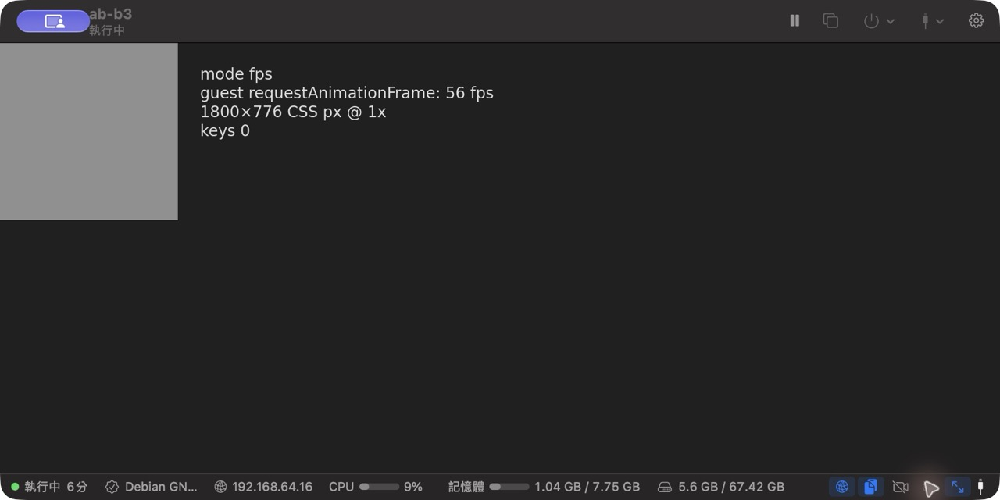
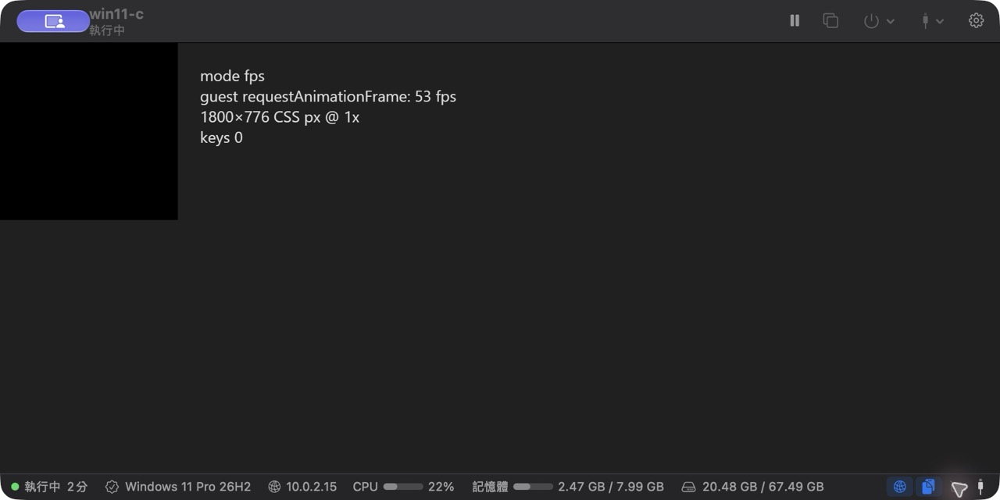
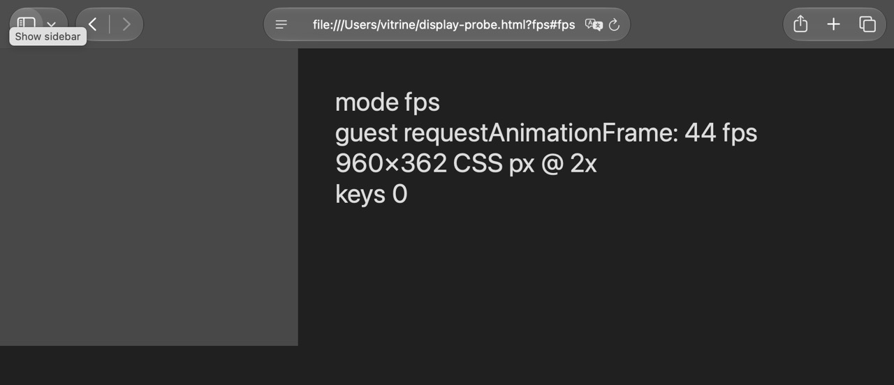
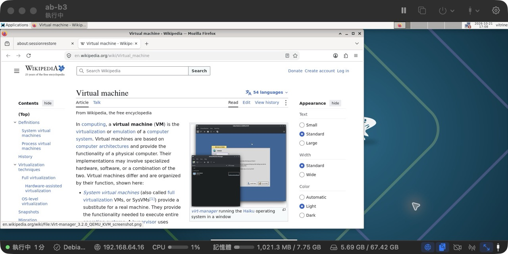
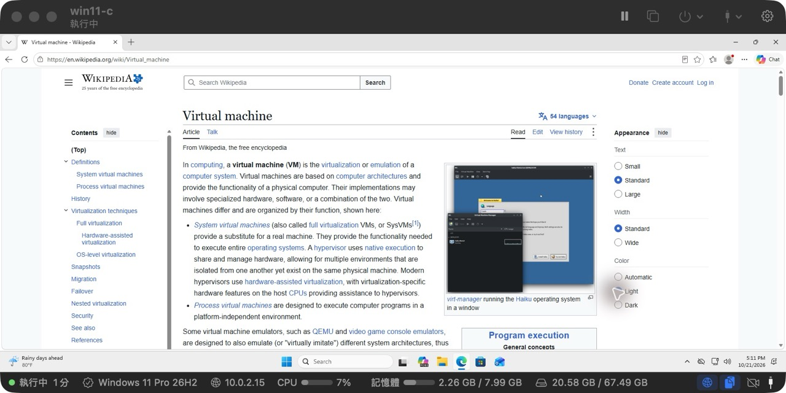
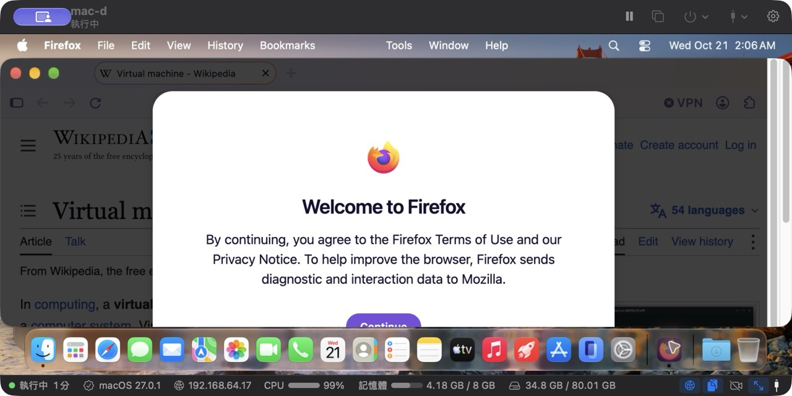
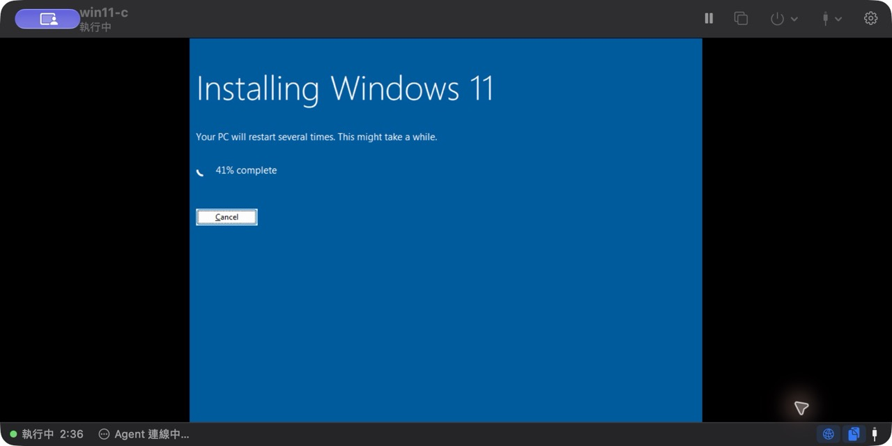
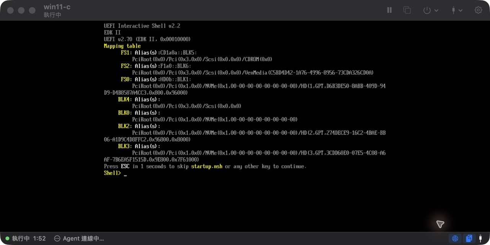

# Verification

What was tested on real guests, when, and on which commit. Every cell names the commit the tested
build came from; a cell is only as current as that commit. Host for all of it: MacBook Pro M1 Max
(64 GB, macOS 27.0.1), under heavy unrelated load (load average 240–380, swap nearly full), which
lowers the display and latency numbers below.

Legend: **PASS** works as documented · **N/A** not available for this guest (see note) ·
**known** works with a documented limitation · **—** not tested in this round.

## Automated suites (2026-10-21)

| Suite | Commit | Result |
|---|---|---|
| `swift test` | cec3c8b, 1d1dfe0; 872efa2; faa3e9e; 12ddf9a | 259 / ~262 tests, 0 failures; 269 tests, 0 failures; 270 tests, 0 failures; 271 tests, 0 failures |
| `go test` (guest agents) | cec3c8b; 12ddf9a | 7 packages ok (needs `-ldflags=-linkmode=external` on macOS 27); `protocol` ok after adding message 0x36 |
| `build-app.sh`, `build-cli.sh`, lifecycle-integrity (14 tests) | cec3c8b | PASS |
| signing-test, release build | 5308f69 | PASS |
| smoke-linux, smoke-qemu-x86, smoke-qemu-arm | 5308f69 | PASS |
| 9p shares (3/3), Secure Boot (3 screenshots), automation | 5308f69 | PASS |
| MCP end-to-end (10 checks, Debian guest) | ba4dd13 | PASS |
| MCP create e2e (`mcp-create-e2e.py`, 14 checks: input rejection, create_vm → running → exec, password not in `ps`, clone_vm, snapshots) | 872efa2; 7ae2c7f | PASS with headless Debian 13 (running and answering `exec` 23 s after create_vm, image cached) and Windows 11 Arm (cached ISO; unattended Setup done and `exec` answering as `mcp-win\vitrine` after 565 s). macOS 27.0.1 from the cached IPSW: PASS, running after 313 s and `exec` answering `Darwin arm64` as `vitrine` after 350 s |
| MCP Unicode typing (`mcp-unicode-e2e.py`: keyboard refuses non-US text, ASCII stays on the keyboard, `auto` switches to the agent, file bytes read back over SSH) | faa3e9e; 12ddf9a | PASS on Debian 13 Xfce (VZ, xfce4-terminal) and Windows 11 Arm (QEMU, Windows PowerShell console) with `héllo wörld ñ ß 字漢かな 한글 😀👍🏽 €`, byte for byte. macOS 27.0.1 (VZ, Terminal), agent never granted Accessibility: PASS byte for byte, the text pasted through the guest clipboard |
| QEMU network e2e: NAT forward, NAT internet, host-only forward and isolation | 1d1dfe0 | PASS; NAT DNS warns (see [known issues](#known-issues)) |

## Fresh installs and feature columns (2026-10-21)

Each guest was installed from scratch with the one-click path, then checked with scripts that print
one PASS/FAIL line per feature; status-bar items were read through the accessibility tree.

| | Debian 13 Xfce | Windows 11 Arm | macOS 27.0.1 |
|---|---|---|---|
| Backend | Virtualization.framework | QEMU + HVF | Virtualization.framework |
| Commit | ec9be81 / ba4dd13 | ba4dd13 (install), 1d1dfe0 (features) | 6befaa1 |
| Install | PASS | PASS, 17.5 min unattended (first try ended in the UEFI shell, see known issues) | PASS, 6.5 min restore + 1 min to agent |
| Agent connects | PASS | PASS | PASS |
| Clock offset | 0 s | −1 s | 0 s (guest stays on PDT, see known issues) |
| NAT internet / DNS | PASS / PASS | known (first fetch failed, retest 200) / PASS | PASS (first fetch after boot timed out, 3/3 retries 200) / PASS |
| Clipboard Mac ↔ guest | PASS both ways | PASS both ways | PASS both ways |
| Shared folder | PASS (virtiofs, read+write) | PASS (SMB `Z:`, read+write) | PASS (virtiofs automount, added live) |
| Drop file on window | PASS | PASS | PASS |
| USB disk image attach/detach | PASS | PASS (32 MB USB disk, gone on detach) | PASS (external disk, volume mounts, gone on detach) |
| TCP / UDP port forward | PASS / PASS | PASS / PASS | PASS / PASS |
| Suspend / resume (same boot, processes kept) | PASS | PASS | PASS |
| Snapshot restore | PASS | PASS | PASS |
| Host-only, named network, bridged, no network | PASS | — | — |
| Mac camera | PASS (~29 fps) | PASS (*Vitrine Camera*, NV12/YUY2 720p/480p) — see known issues | N/A: needs a team-signed agent; the app explains why and offers *Install Camera Support* |
| Bluetooth LE (experimental) | PASS (178 reports, 13 devices) | N/A (Linux only) | N/A (Linux only) |
| Status bar (OS, IP, CPU, memory, disk, toggles) | PASS | PASS | PASS |
| MCP server | PASS | — | — |
| Browser installed in the guest, web page loads | PASS (Firefox ESR 153.5 from Debian's archive) | PASS (Edge 155, built in) | PASS (Firefox 158.0.1 downloaded from Mozilla; its first-run terms dialog left open) |

Windows 11 x64 (QEMU TCG) was not reinstalled in this round: no x64 ISO was cached and the emulated
setup takes about two hours. Its last results: unattended install in 1 h 53 min on 2026-10-18
([benchmarks.md](benchmarks.md)), and on 2026-10-19 a separate run (on a copy of an
installed guest) covered agent reinstall, file drop, read-write and read-only shares, exact Unicode
text input, memory and disk snapshot restore and clone isolation. That run found Notepad dropping
Unicode input in new documents while Spell check is on.

## Display: frame rate and key-to-pixel latency (2026-10-21)

`scripts/bench/display-probe.py` with `display-probe.html` full screen in the guest's browser,
measured on the Mac through Vitrine's own display path (one clock, no guest timestamps).

| Guest | Browser | Delivered fps (guest rAF) | Key → pixel median / p95 | Missed |
|---|---|---|---|---|
| Debian 13 (VZ) | Firefox ESR `--kiosk` | 28.1 (56) | 49.2 ms / 78.2 ms; rerun 47.6 / 63.3 | 0 / 40 |
| Windows 11 Arm (QEMU) | Edge kiosk | 18.6 (53) | 118.4 ms / 170.4 ms | 0 / 40 |
| macOS 27 (VZ) | Safari full screen | 25.3 (44) | 44.5 ms / 102.7 ms | 0 / 40 |

An earlier run on 2026-10-19 (lighter host load) measured about 28.9 fps for macOS and
20.4 fps for Windows 11 Arm, and a Windows key-to-frame median of 63.4 ms (p95 77.9 ms).

## Performance (2026-10-21)

Guest against the Mac, same 7-Zip 26.04 build, measured one after the other (the guest suspended
while the Mac ran). Full method and the older runs: [benchmarks.md](benchmarks.md).

| | Debian 13 (VZ, ba4dd13) | Windows 11 Arm (QEMU, 1d1dfe0) | macOS 27 (VZ, 6befaa1) |
|---|---|---|---|
| 7-Zip 1 thread (MIPS) | 4 689 (84% of Mac) | 5 481 (~99%) | 5 062 (91%) |
| 7-Zip 4 threads (MIPS) | 20 945 (97%) | 24 707 (~114%) | 23 755 (110%) |
| Disk | fio: seq write 4.00 GB/s, read 7.28 GB/s, 4K QD32 read 206 k IOPS | seq write 5.9 GB/s, read 6.4 GB/s, 4K read 39.6 k IOPS | — |

Mac on the same day: 5 559 / 21 600 MIPS. Figures above 100% come from the guest being
measured at a different moment of the host's load; treat everything within ±15% as "native speed".

## Known issues

- **Windows camera: agent hung once.** Right after the first camera install on win11-c the agent
  stopped answering 10 s after frames started; the stuck process could not be killed and the VM had
  to restart. Not reproduced in three later tries (idle 35 s, MediaCapture photo, camera on at boot).
  The guest agent log also showed an earlier "Insufficient system resources" virtio-serial read error.
- **QEMU NAT DNS on IPv6-first Macs.** Windows asks slirp's 10.0.2.3 first and only falls back to
  fec0::3 after a timeout, so some lookups fail on the first try ([networking.md](networking.md)).
- **Windows 11 Arm install, first try ended in the UEFI shell** with an empty partitioned disk: the
  likely cause is the Return taps that start the install disc landing on Setup's Cancel (not proven;
  the second try succeeded with the same build). 1d1dfe0 taps Down instead; a blank VM reached Setup
  17% in 90 s with it.
- **`vitrinectl create --password` is visible in `ps`** while the command runs. Use
  `--password-stdin` (what the MCP server's `create_vm` uses), the app, or a single-user Mac.
- **macOS guests kept Pacific time** after a one-click install. Since 6b67401 setup finalization sets
  the Mac's zone; `vitrinectl agent finalize mcp-mac` moved that guest from US/Pacific to Asia/Taipei.
- **macOS guest camera** needs the agent signed by a team ([signing.md](signing.md)); ad-hoc builds
  show the explanation instead.
- **macOS 27 guests asked whether VitrineAgent may "control this Mac and access your data"** at
  every login. Since 12ddf9a the agent asks only when the user does (the *Allow…* bar in the VM
  window, 3daba1f); after reinstalling it and restarting the VM no prompt appeared (only macOS's
  informational "App Background Activity" notice). Asked from the bar in `mcp-mac`, the person at
  the VM allowed it: the agent restarted by itself with Accessibility, then with Screen Recording,
  and the bar went away. macOS 27 lists the two separately: Accessibility as *Device Control and
  Data Access*, Screen Recording under *Screen & System Audio Recording*, and shows the Screen
  Recording prompt only once per app, so asking again showed nothing; since 88e70fc the agent
  opens that list instead (built, not yet run in a guest: reinstalling the ad-hoc signed agent
  would drop the grants just made).
- **Dock items** were checked in the earlier GUI pass, not in this round (the accessibility tooling
  used here cannot reach the Dock).

## Screenshots

Web page in a browser in each guest (VM window, with Vitrine's status bar):

Windows 11 Arm install:

